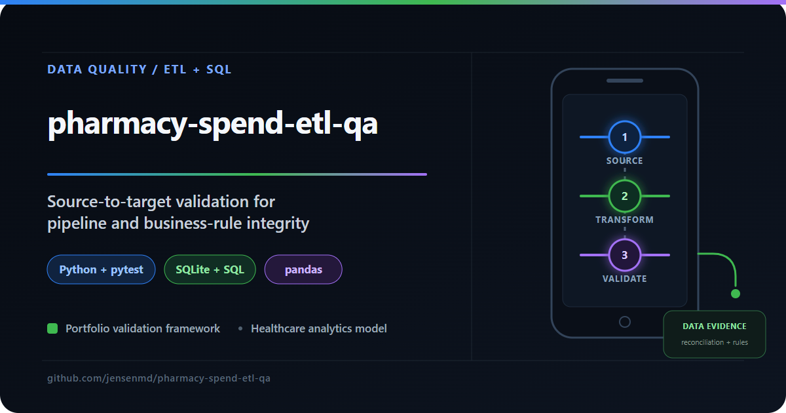

# pharmacy-spend-etl-qa

Pharmacy spend reporting is useful only when the numbers reconcile. This project follows synthetic data from source files through an ETL pipeline into SQLite, using SQL-driven checks to verify completeness, financial calculations, and relationships. The generated data is modeled after the CMS Medicare Part D dataset.

Built to demonstrate the source-to-target validation discipline used in enterprise healthcare QA — specifically the approach developed over five years testing the **Rx Analytics platform at GHX (Global Healthcare Exchange)**.




Built by **Michael D. Jensen** — Senior QA Engineer with 15+ years of enterprise testing experience, including five years as Senior QA Engineer on a pharmaceutical spend analytics platform in a HIPAA-compliant environment.

🔗 [LinkedIn](https://www.linkedin.com/in/michaeljensen-qa/) | 📧 jensen.md@gmail.com

---

## What It Does

Simulates a three-stage pharmacy spend data pipeline and validates each stage:

```
Source CSV files          →     ETL Pipeline          →     SQLite Warehouse
(raw pharmacy spend data)       (transform + load)          (fact + dim tables)
        ↑                                                           ↓
  generate_source_data.py           etl_pipeline.py         pytest validation suite
```

The pytest suite runs SQL queries directly against the warehouse and validates:
- Row count reconciliation (source vs. warehouse)
- Financial accuracy (spend totals, claim counts)
- Manufacturer rollup integrity (aggregate vs. fact table)
- Business rule validation (beneficiary logic, category assignments)
- Data quality checks (nulls, negatives, duplicates, formatting)
- Referential integrity (foreign key consistency)

The numbers have to reconcile from source to warehouse. Targeted SQL queries check totals, business rules, and relationships, with coverage informed by where calculation errors would have the greatest impact.

---

## Project Structure

```
pharmacy-spend-etl-qa/
├── .github/
│   └── workflows/
│       └── ci.yml                  # GitHub Actions: generate → ETL → validate
├── data/
│   ├── generate_source_data.py     # Synthetic Part D data generator
│   └── raw/                        # Generated source CSV files
│   └── processed/                  # SQLite warehouse database
├── etl/
│   └── etl_pipeline.py             # Extract → Transform → Load pipeline
├── tests/
│   └── test_etl_validation.py      # pytest validation suite (SQL-driven)
├── reports/                        # Generated HTML test reports + ETL logs
├── conftest.py
└── requirements.txt
```

---

## Test Coverage

| Category | Tests | What's Validated |
|---|---|---|
| Row Count Reconciliation | 3 | Source vs. warehouse counts, dimension completeness |
| Spend Total Validation | 3 | Total spending, claim counts, spending-per-claim accuracy |
| Manufacturer Rollups | 3 | Aggregate vs. fact table, claim count sums, coverage |
| Drug Category Validation | 2 | Valid categories, category spend rollup completeness |
| Data Quality | 7 | Nulls, negatives, zero claims, beneficiary/claim consistency, uppercase normalization, year validity, duplicates |
| Referential Integrity | 2 | Foreign key consistency across fact and dimension tables |
| **Total** | **20** | |

---

## Data Model

```
dim_manufacturer          dim_drug
─────────────────         ──────────────────────
manufacturer_id (PK)      drug_id (PK)
manufacturer_name         drug_name
                          generic_name
                          drug_category
         │                      │
         └──────────┬───────────┘
                    ↓
            fact_drug_spend
            ───────────────────────
            spend_id (PK)
            drug_id (FK)
            manufacturer_id (FK)
            year
            claim_count
            total_spending
            spending_per_claim
            beneficiary_count
            unit_count
            load_timestamp
                    │
                    ↓
        agg_manufacturer_spend
        ───────────────────────────
        Pre-computed rollup by manufacturer/year
```

---

## CI Pipeline

GitHub Actions is configured for pushes and pull requests to `main`:
1. Generates synthetic source data
2. Runs the ETL pipeline
3. Executes the full validation suite
4. Uploads HTML report as a downloadable artifact

---

## Background

This project mirrors the QA validation workflow used on the **Rx Analytics platform at GHX (Global Healthcare Exchange)**, where the primary QA discipline was validating pharmaceutical spend data flowing through:

- Nightly batch ingestion from pharmacy source files
- Informatica ETL transformation
- SQL Server data warehouse
- Business Objects BI reporting layer

The core validation approach — risk-based SQL spot-checking against the warehouse, reconciling source data against transformed output, validating business rule calculations — is directly reflected in this test suite.

The business context was real and high-stakes: pharmacy chains and hospital pharmacy systems used these reports to make purchasing decisions worth millions of dollars annually. Validating that tiered pricing thresholds, brand vs. generic spend calculations, and savings opportunity reporting were accurate wasn't just a QA exercise — it was ensuring that financial recommendations to clients were correct. That context shaped how this validation suite was designed: coverage driven by where errors would have the most impact, not just by what was easiest to test.

---

## Running Locally

**Prerequisites:** Python 3.9+

```bash
# Install dependencies
pip install -r requirements.txt

# Step 1: Generate source data
python data/generate_source_data.py

# Step 2: Run ETL pipeline
python etl/etl_pipeline.py

# Step 3: Run validation suite
pytest tests/ -v

# Optional: generate HTML report
pytest tests/ -v --html=reports/validation-report.html --self-contained-html
```

---

## QA Portfolio Quick Reference

See [Michael D. Jensen’s QA portfolio](https://github.com/jensenmd) for the complete project overview.

| Project | Purpose and Approach |
| --- | --- |
| [fhir-api-qa](https://github.com/jensenmd/fhir-api-qa) | Checks whether a healthcare API preserves Patient data through its lifecycle, with isolated FHIR tests and useful CI failure evidence. |
| [pharmacy-spend-etl-qa](https://github.com/jensenmd/pharmacy-spend-etl-qa) **(this repository)** | Checks that pharmacy spend data survives the trip from source files to analytics tables, using SQL reconciliation on a synthetic pipeline. |
| [restful-booker-qa](https://github.com/jensenmd/restful-booker-qa) | Tests booking behavior at both API and browser layers, combining Postman/Newman and Playwright for repeatable regression feedback. |
| [qa-automation-showcase](https://github.com/jensenmd/qa-automation-showcase) | Examines API behavior and the quality of returned data together, using pytest, Postman, and Python validation. |
| [android-appium-wdio-poc](https://github.com/jensenmd/android-appium-wdio-poc) | Builds a focused baseline for Android UI checks, exercising Settings navigation on a local emulator with Appium and WebdriverIO. |
| [mapmyrun-quality-investigation](https://github.com/jensenmd/mapmyrun-quality-investigation) | Investigates how workout tracking affects data integrity and user trust, using mobile field experiments and separating observations from explanations. |
| [ai-qa-framework](https://github.com/jensenmd/ai-qa-framework) | Explores how AI can help develop useful API test coverage while keeping a QA engineer responsible for review and pytest execution. |
| [claude-code-qa-sessions](https://github.com/jensenmd/claude-code-qa-sessions) | Shows how human QA judgment guides Claude Code from finding coverage gaps to making targeted, reviewed test improvements. |
| [agentqa-orchestrator](https://github.com/jensenmd/agentqa-orchestrator) | Explores inspectable AI code reviews, using Gemini and Pydantic-defined response schemas to produce structured JSON audit artifacts. |

---

## Author

**Michael D. Jensen** — Senior QA Engineer
15+ years of enterprise software testing experience across healthcare IT, financial systems, telecommunications, and cybersecurity. Deep background in REST API validation, ETL pipeline testing, SQL-based data integrity verification, and full-stack manual testing in Agile environments.

Five years on a pharmaceutical spend analytics platform — validating complex business rules, ETL pipelines, and financial reporting in a HIPAA-compliant environment.

Current hands-on work includes Python/pytest automation, Playwright UI testing, and CI/CD-integrated quality practices.

🔗 [LinkedIn](https://www.linkedin.com/in/michaeljensen-qa/) | 🐙 [GitHub Profile](https://github.com/jensenmd) | 📧 [jensen.md@gmail.com](mailto:jensen.md@gmail.com)
